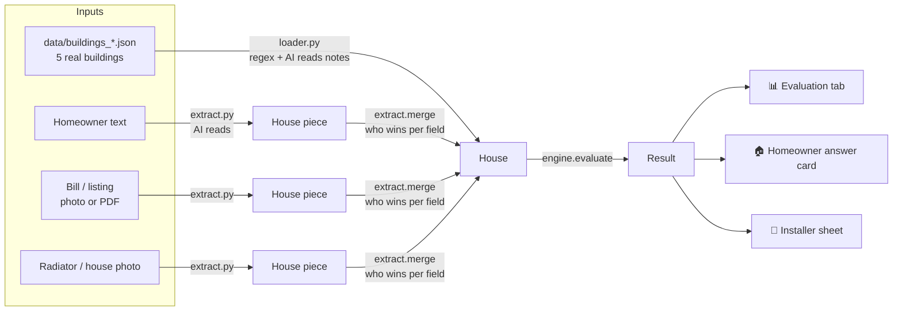

# How HP-Ready works (data flow + where to change things)

**One line:** inputs become a `House`, the engine turns a `House` into a `Result`, the app only shows the `Result`.
The AI only *reads* (text, bills, photos). The engine (plain Python physics) *decides*.

## 1. Data flow



Plain text version:

```
data/*.json ──loader.py──┐
homeowner text ──┐       │
bill / listing ──┼─extract.py─> pieces ──merge──> House ──engine.evaluate──> Result ──app.py──> 3 tabs
photos ──────────┘       │
```

- **`House`** = everything we know about one home. Every value also has a `source` (data / text / bill / photo / confirmed) and a `confidence`. Unknown stays `None`.
- **`Result`** = the answer: colour, probabilities, flow temperature range, heating load, cost, contradictions, open checks, installer brief.
- Both are defined once in **`schema.py`**. That file is the contract between everyone.

## 2. Files

| File | Owner | What it does |
| --- | --- | --- |
| `schema.py` | Junwoo | `House`, `Result` and all fixed numbers (prices, JAZ, W/m² table, radiator table). Names are frozen; ask before adding a field. |
| `loader.py` | Junwoo | Reads the 5 organiser buildings into `House`. Numbers by regex; notes facts by AI (cached in `data/notes_cache.json`). Also holds the shared AI call `llm_tool`. |
| `extract.py` | Junwoo | Homeowner inputs → `House`: one AI call per input ("mission"), cached in `samples/cached_extract.json`. `merge` combines pieces and logs disagreements in `House.conflicts`. |
| `engine.py` | engine team | The physics: `House` → `Result`. Deterministic (seed 0). |
| `engine_tracer.py` | nobody (frozen) | Copy of the original engine. The app uses it per building only when `engine.py` fails. Don't edit. |
| `data/baseline_results.json` | engine team | Snapshot of the key numbers per building, for `python loader.py --compare-baseline`. |
| `calibrate.py` | engine team | Fits the one tuning number `k` on the 3 dev buildings; leave-one-out errors for the Evaluation tab. |
| `app.py` | Junwoo | Streamlit UI, three tabs. Never calculates physics; only calls `engine`. |

## 3. "I want to change X" → edit here

| I want to change… | Edit | Notes |
| --- | --- | --- |
| How the colour is decided (55 / 60 °C bands, caps) | `engine.py`, `_physics`, block `# ---- step 6 traffic light` | Bands themselves: `schema.py` `BAND_GREEN_MAX_C`, `BAND_YELLOW_MAX_C` |
| Heating load method (W/m² × area × k) | `engine.py`, `setup` (`# W/m²`, `# area`) and `_physics` `# ---- step 2 area × age` | W/m² table: `schema.py` `W_PER_M2` |
| Radiator output / flow temperature formula | `engine.py`, `flow_from`, `phi_needed`, `_physics` `# ---- step 3 radiators → flow temperature` | Radiator sizes in kW: `schema.py` `RADIATOR_KW` |
| Single-pipe penalty | `engine.py`, `setup` `# pipe system (step 3b)` | Penalty range: `schema.py` `Params.single_pipe_penalty_k` |
| Bill → yearly kWh, boiler efficiency, hot water | `engine.py`, `fuel_kwh`, `eta_of`, `_physics` `# ---- step 1 fuel → heat` | |
| Uncertainty (Monte Carlo ranges, probabilities) | `engine.py`, `monte_carlo` | N = 500, seed 0 |
| Contradiction rules (bill vs area, wood stove, …) | `engine.py`, `_physics` `# ---- step 2b contradictions` | |
| The one-sentence reason / "what's still open" | `engine.py`, `_reason`, `_open_checks` | |
| Installer visit type, parts, checklist | `engine.py`, `installer_brief`, `_parts`, `confidence_of` | |
| Next question we ask the homeowner | `engine.py`, `QUESTIONS`, `_next_question` | |
| The tuning number `k` | `calibrate.py` (then `schema.py` `Params.k` default) | Run `python calibrate.py` |
| Prices, JAZ | `schema.py` constants | Fixed by the challenge: don't change |
| What the AI reads from text / photos / bills | `extract.py`, `SYSTEM` and `HINT` | Then delete the old entries from `samples/cached_extract.json` so they are re-read |
| What the AI reads from building notes | `loader.py`, `NOTES_SYSTEM` | Then delete `data/notes_cache.json` entries and run `python loader.py` |
| Which input wins when two disagree | `extract.py`, `ORDER`, `GROUP` in `merge` | |
| Screen text, layout, colours | `app.py` (`answer_card`, `tab_evaluation`, `tab_homeowner`, `tab_installer`) | Theme: `.streamlit/config.toml` |
| Add a new field everyone can use | `schema.py` first (tell the team), then fill it in `loader`/`extract`, use it in `engine`, show it in `app` | |

Line numbers move; search for the `# ---- step` comments in `engine.py`.

## 4. Replacing the engine

The app only needs these, so you can rewrite everything inside `engine.py`:

```python
evaluate(h: House, p=DEFAULT, n=500, seed=0) -> Result   # must be deterministic
installer_brief(h: House, r: Result) -> Result            # may just return r if evaluate already filled it
next_question(h: House) -> str | None                     # optional
```

Fields the screens read (fill them or the UI shows "–"): `best_color`, `verdict_basis`, `boundary`, `reason`, `p_green/p_yellow/p_red`, `required_flow_temp_c`, `heat_load_kw`, `heat_load_bill_kw`, `jaz_bucket`, `cost_now_eur`, `cost_hp_eur`, `saving_eur`, `contradictions`, `open_checks`, `hints`, `trace`, `visit_type`, `parts`, `installer_checklist`, `path_to_yellow`, `lead_score`, `next_step`.

**Structured fields (preferred).** The engine fills numbers and kinds, the app writes the sentences. If they stay empty the app falls back to reading the text fields above.

- `options`: list of `Option` (kind `radiators` / `insulation` / `pipe_loop` / `none`, with `add_rated_kw_55`, `loss_cut_pct`, …): the ways to reach 55 °C.
- `radiators`: `RadiatorSummary` (count, assumed size, rated kW today, kW needed at 55 / 60 °C, margin %).
- `flags`: list of `Flag` (`text`, `src`, `kind`): house-specific issues for the installer. One sentence, no "Check on site:" prefix, never one of the always-checks.
- `always_checks`: the checks done at every visit (else `engine.ALWAYS_CHECKS`, else the app defaults).

**Contract check.** `schema.check_result(h, r)` lists anything that would show as "–" or nonsense (probabilities not summing to 1, p10 > p50, empty UI fields, red with missing data, …). The Evaluation tab prints its findings as small grey lines under the table. Nothing printed = fine.

**Safety nets.**

- **Tracer fallback.** `engine_tracer.py` is a frozen copy of the original engine. If `engine.py` fails to import, or raises for one building, the app shows the tracer result for that building only, with a small "tracer" chip and a grey line in Evaluation ("B-04: new engine failed (ValueError: …), showing the tracer result"). Don't edit `engine_tracer.py`. If both fail, the building shows "No result".
- **Baseline.** `data/baseline_results.json` holds the key numbers per building (colour, probabilities, flow p10/p50/p90, load, visit type, lead score).
  - `python loader.py --compare-baseline`: what moved since the snapshot (`!!` = colour changed).
  - `python loader.py --save-baseline`: save a new snapshot, **only after an intended change**.
  - The Evaluation tab shows "Compared with the saved baseline" only when a colour changed, flow p50 moved ≥ 1 °C or load ≥ 0.3 kW.
- The app's result cache includes the `engine.py` file time, so editing the engine while Streamlit runs is picked up on the next click.

## 5. Run and check

```bash
python engine.py          # 5 buildings + one Rechenweg; expect B-01 green, B-02 green, B-03 yellow, B-04 not green
python calibrate.py       # k ≈ 1.01, leave-one-out ≈ +20 / −9 / −8 %
python loader.py --compare-baseline   # after any engine change: what moved vs data/baseline_results.json
streamlit run app.py      # turn on "Demo mode" (top right): cached reads only, no API needed
```

## 6. Team rules

- Work on your own branch, merge into `main` every 1-2 hours (`docs/TEAM_GIT.md`). `main` must always run.
- Don't edit someone else's file; tell them. `schema.py` changes go straight to `main`, through Junwoo.
- The AI never outputs colours, verdicts or calculated numbers; only raw values with a quote.
- No made-up numbers: unknown stays `None`; prices only from `schema.py`; never installation cost or subsidies.
- Full spec: `CLAUDE.md`. Engine task list and expected numbers: `ENGINE_PLAN.md`.
