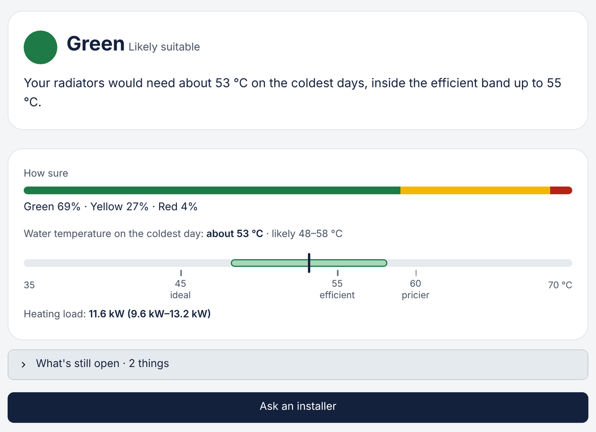
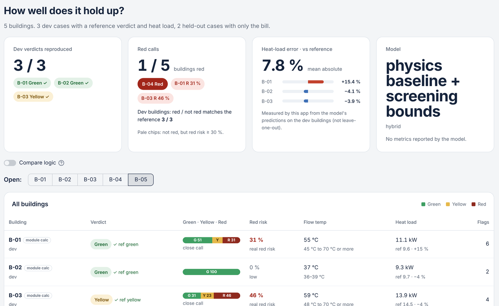

<div align="center">

<picture>
  <source media="(prefers-color-scheme: dark)" srcset="assets/brand/nuuai-logo-tagline-dark.svg">
  
</picture>

# HP-Ready

**Is this home ready for a heat pump? An honest first answer in under three minutes.**
<br>Green, yellow or red, with probabilities, the reason, and what a technician still has to check.

<a href="https://hp-nuuai.streamlit.app"></a>


</div>

<br>

<p align="center">
  
</p>

---

## 👩‍⚖️ For judges: try it in 2 minutes

No install, no account, no API key.

**1. Open [hp-nuuai.streamlit.app](https://hp-nuuai.streamlit.app)**
<br><sub>If you see a sleeping page, click "Yes, get this app back up!" and wait about 30 seconds.</sub>

**2. Homeowner tab: let an example house do the typing**

| Click | What you'll see |
| --- | --- |
| Scroll to **Or try an example house** → **Use this house** on *The Webers' terraced house* | The form fills in, a radiator photo and a gas bill are attached |
| **Next** → **Next** → **Next** | Each step shows what was read; the right panel lists every value with its source (form / bill / photo) |
| **Show my answer** | 🟢 **Green · likely suitable**: 69 % green, about 53 °C on the coldest day, 11.6 kW heating load |
| Open **What's still open** | What we couldn't tell from the data and what a technician must check on site |
| **Ask an installer** | The request is already filled in from the result. The homeowner only adds name, contact and postcode, then **Open as e-mail** |

Then press **Change answers** and try the other example houses. Each one shows a different behaviour:

| Example house | What it shows |
| --- | --- |
| **Haus Schneider** | The form says oil, the bill says gas. Step 4 **asks you which is right** before it gives an answer, instead of silently picking one |
| **The old farmhouse** | Build year unknown → 🟡 **Yellow · can't tell yet**, plus the one thing that would settle it. Missing data is never a red |
| **The Kaya family's house** | Underfloor heating → 🟢 Green, 100 %, about 37 °C |

**3. Evaluation tab: the organiser's five buildings**

<p align="center">
  
</p>

- **Dev verdicts 3 / 3** reproduced (B-01 green, B-02 green, B-03 yellow), heat-load error 7.8 % on average.
- Use **Open:** to pick a building. **B-04** and **B-05** are the evaluation buildings.
  - **B-04**: single-pipe system, needs above 60 °C with today's radiators → 🔴 red, with what gets it to yellow.
  - **B-05**: the data contradicts itself (125 m² but 14 rooms, a bill 76 % above what size and age say). The tool says which source it trusted and why.
- **How we got this** shows every calculation step with its number and assumption.

> [!TIP]
> Toggle **Demo mode** (top right) to use only cached AI reads. Every answer is reachable without a live AI call.

---

## What it does

For each home it returns:

- 🚦 a traffic light **with probabilities**, using the organiser's meanings:
  🟢 likely suitable · 🟡 checks remain, or too little data to tell · 🔴 an obstacle in the data we have
- ❓ **what's still open**: what we can't tell yet and what a technician must check on site
- 🌡️ the required flow temperature and the heating load as **ranges**, not single guesses
- ⚠️ **contradictions** in the data, and which source we trusted
- 🔧 a **ready-made installer request**: the homeowner adds a name and a postcode, the rest comes from the result
- 🧰 installer prep (Installer tab, `HP_SHOW_INSTALLER=1`): remote quote / visit with parts / hold, radiators to swap, on-site checks
- 💶 running cost now vs with a heat pump (challenge price assumptions only)

## How it decides

```
 Form · radiator photo · bill · free text
                 │
                 ▼
   AI reads (optional, only on request)      ← pulls raw facts, quotes its source, never decides
                 │
                 ▼
      Physics engine decides                  ← area × W/m² by age × k  →  heating load
                 │                              → radiator output (EN 442) → required flow temperature
                 ▼                              → Monte Carlo over every unknown
  🟢 / 🟡 / 🔴 + probabilities + what's open
```

- **The LLM only reads.** It turns notes, bills and photos into fields and quotes what it used. No verdicts, no arithmetic.
- **Unknown stays unknown.** Missing values become ranges and probabilities, never invented numbers.
- **Red is earned.** Red means an obstacle in the data. Missing data is yellow, "can't tell yet".
- **One calibrated number.** k = 1.01, fitted on the three dev buildings.

## Run it locally

```bash
git clone https://github.com/jackylee0503/hp-ready.git && cd hp-ready
python -m venv .venv
source .venv/bin/activate        # Windows: .venv\Scripts\activate
pip install -r requirements.txt
streamlit run app.py
```

Open the local URL it prints (usually http://localhost:8501).

Optional: put `ANTHROPIC_API_KEY = "sk-ant-..."` in `.streamlit/secrets.toml` for live reading of your own text, bills and photos. Without it, the app uses the cached reads in `data/notes_cache.json` and `samples/`, then a keyword fallback.

## Repo map

| Path | What |
| --- | --- |
| `app.py` | Streamlit app: Homeowner and Evaluation tabs (Installer tab with `HP_SHOW_INSTALLER=1`) |
| `engine.py`, `calibrate.py` | physics engine (baseline) and calibration |
| `schema.py`, `CONTRACT.md`, `contracts/` | the one data contract every input and output follows |
| `orchestrator.py`, `modules/` | plug-in slots: pipe classifier, bill reader, calculation |
| `loader.py`, `extract.py` | data loading, notes and photo reading |
| `data/` | organiser data (anonymised): 3 dev + 2 evaluation buildings, labelled radiator photos |
| `assets/demo/` | fictional demo inputs (bill, listing, house texts) with expected values |
| `assets/brand/` | nuuAI logo and colours |
| `docs/challenge/` | the organiser's challenge pages |
| `docs/DESIGN.md`, `docs/PITCH.md` | design decisions and pitch script |

---

<div align="center">

<br>
<sub>Built by team <b>nuuAI</b> at WATT THE HACK Munich 2026 for nuuEnergy challenge #4.<br>
First estimate, not a DIN EN 12831 calculation. Prices are the challenge's fixed assumptions. Nothing you enter is stored.</sub>
</div>
