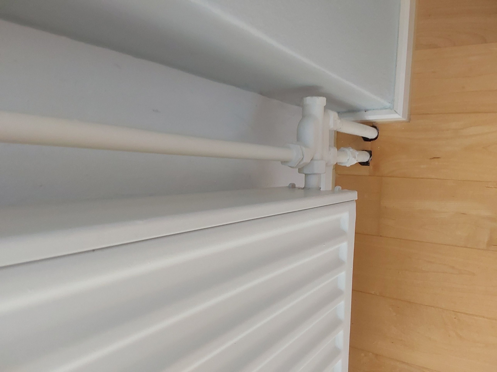
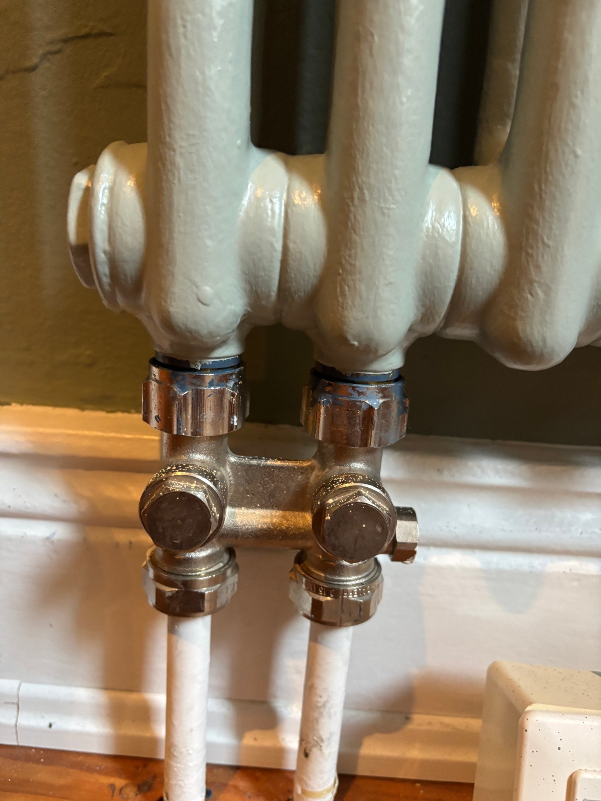
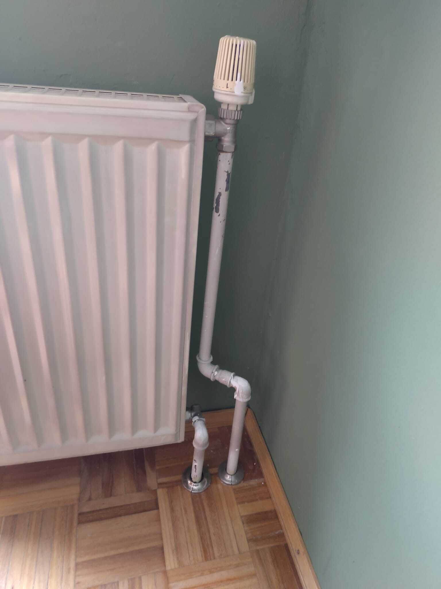
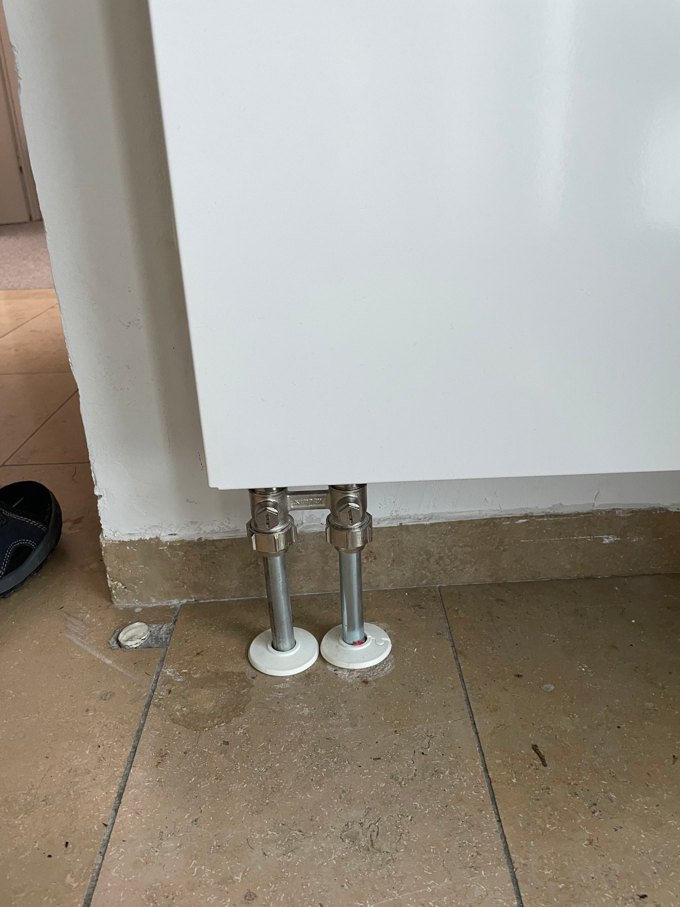
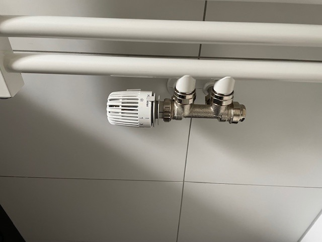

# Background: Single-pipe vs. two-pipe heating

<aside>
💡

One field in the dataset is `pipe_system` (two-pipe / single-pipe / unknown). This page explains what that means, why it matters for heat pumps and why it is often hard to tell from photos.

</aside>

## The difference in one sentence each

- **Two-pipe system (Zweirohrheizung):** every radiator gets hot water from a shared supply pipe and sends the cooled water back through a separate return pipe. All radiators get water at roughly the same temperature.
- **Single-pipe system (Einrohrheizung):** one pipe runs as a loop from radiator to radiator. Each radiator takes some water out of the loop and puts it back into the same pipe. So the water gets cooler from radiator to radiator.

Single-pipe systems were common in German buildings from the 1960s and 1970s, especially in apartment buildings. Most other buildings use two-pipe systems.

## Why it matters for heat pumps

A heat pump works most efficiently at a low flow temperature (see the JAZ values in the One-Pager).

- In a single-pipe loop, the last radiators only get water that has already cooled down. To keep those rooms warm, the system usually needs a **higher flow temperature**, which means a lower JAZ and higher running costs.
- Single-pipe loops are **harder to balance**. Water partly bypasses the radiators, so the return water stays warm, which heat pumps don't like.
- This is **not a deal-breaker**. Heat pumps can work with single-pipe systems, but a technician usually has to check things first: for example larger radiators at the end of the loop, a higher flow temperature or converting parts of the system.

Rule of thumb for your tool: a confirmed single-pipe system is rarely a clean "green" without an on-site check.

## How to spot it in photos

| What you see | What it points to |
| --- | --- |
| Valve at the top, return fitting at the bottom, two separate pipes with no connection between them | Likely two-pipe |
| One pipe running along the wall or skirting from radiator to radiator, often with a short bypass piece between the pipes | Likely single-pipe |
| One single connection at the bottom of the radiator, both pipes coming from the floor into one valve | Often single-pipe, but two-pipe versions of this valve exist |
| Compact valve block under the radiator ("H-block") with two pipes | Often can't tell: these exist for both systems. An extra adjustable port on the side (for the bypass) points to single-pipe |
| Construction year 1960s to 1970s, apartment building | Single-pipe more likely, but not proof |

## Why photos are often not enough

- **Two pipes at a radiator do not mean two-pipe.** Single-pipe radiators also have two connections.
- **The system belongs to the building, not to one radiator.** A brand-new bathroom radiator on an old single-pipe loop is still single-pipe.
- The best evidence is usually not at the radiator: how the pipes run *between* radiators, markings on the valve, or the pipe layout in the boiler room.

Even experienced installers are sometimes unsure from a single photo.

## What we expect from your tool

- If `pipe_system` is given, use it.
- If it is `unknown`, you can estimate it from photos and construction year, but **show how confident you are** and why.
- If you can't tell, say so. For example: *"Heating pipe system unclear from the photos. A technician should check whether this is a single-pipe system, because that can require a higher flow temperature."*

This is exactly what the jury means by **handling uncertainty**.

## Photo examples

<aside>
✅

Real photos from nuuEnergy projects (anonymised), each assessment confirmed by a heating installer.

</aside>

### 1. Single-pipe: the classic loop

Single-pipe. A long pipe runs along the wall and is tapped by a fitting at the radiator. The installer called this a textbook single-pipe example.

### 2. Single-pipe: hidden in a valve block

Single-pipe. Looks like a normal H-block, but the extra port on the right is where the bypass is adjusted.

### 3. Two-pipe: the classic layout

Two-pipe. Valve at the top, separate return at the bottom, two separate pipes into the floor.

### 4. Two-pipe: modern valve block

Two-pipe. A newer two-pipe H-block. Compare with example 2: no bypass port on the side.

### 5. Can't tell from the photo

Unknown. This bathroom valve block works with both systems. Even the installer could not decide from the photo, so your tool shouldn't either.